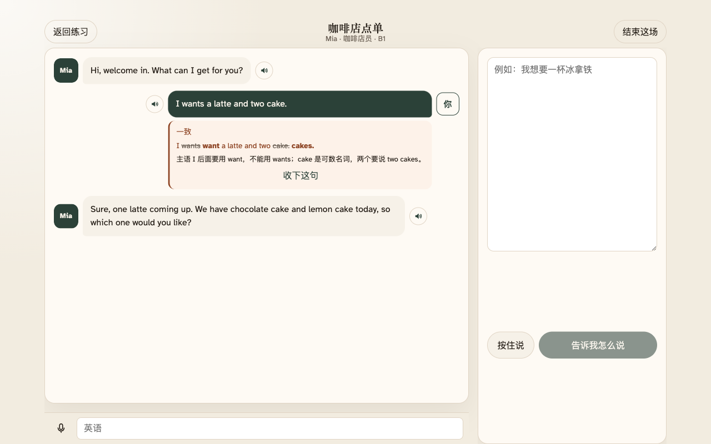
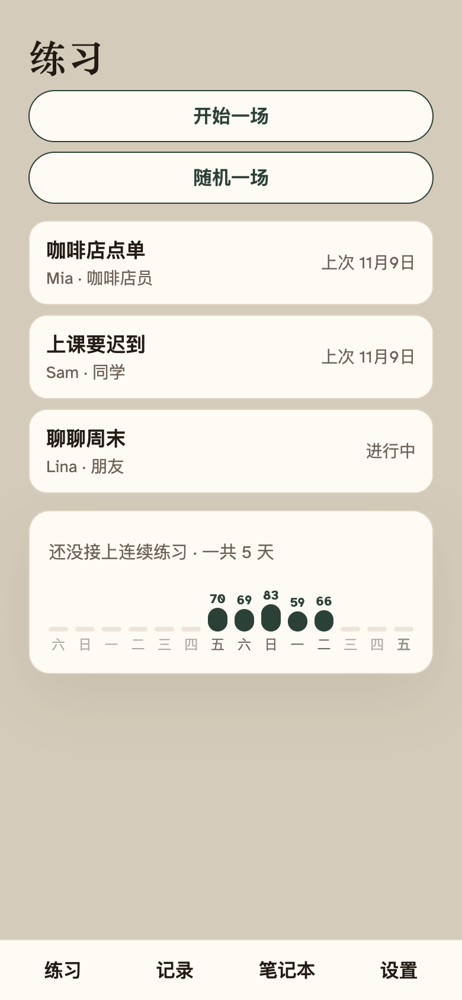
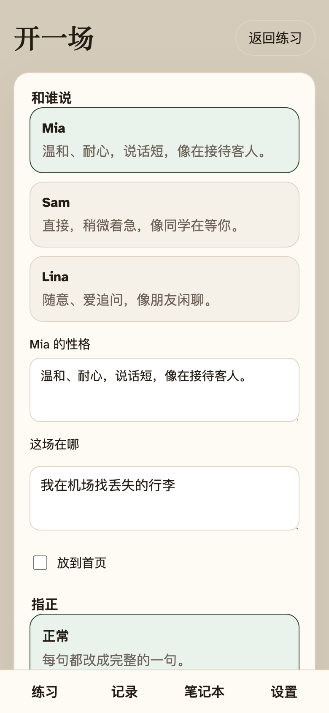
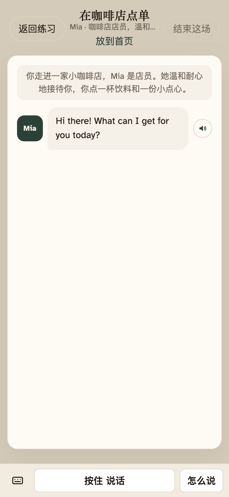
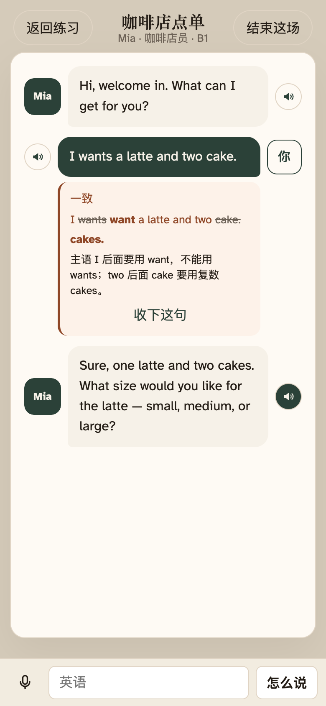
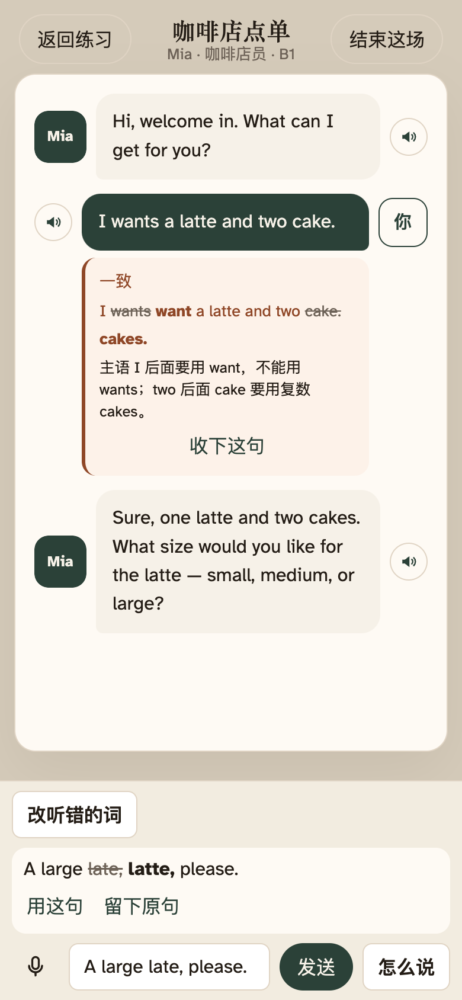
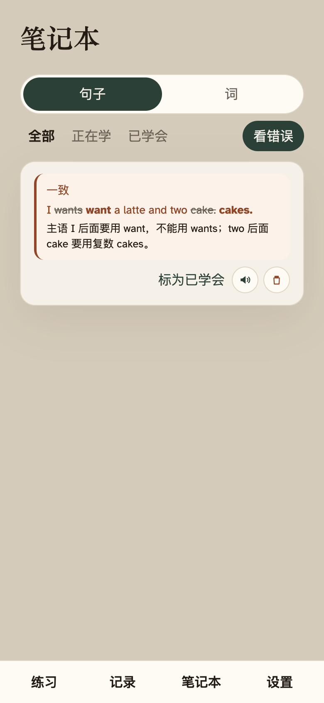

<h1 align="center" style="text-align: center">Speak With Me</h1>

<p align="center" style="text-align: center">先敢说，再说好。</p>

<p align="center" style="text-align: center">
  <a href="https://github.com/Long-zhengtian/SpeakWithMe/blob/main/LICENSE"></a>
  <a href="https://github.com/Long-zhengtian/SpeakWithMe/pulls"></a>
  <a href="https://react.dev"></a>
</p>

<p align="center">
  
</p>

## 开一场

首页上已有的场景可以直接开始。

**开始一场**用中文写下这场的处境，再选一个人和你说。可以改这个人的性格，也可以这场先不改句子。勾上「放到首页」，这场会留在练习页。

**随机一场**不用写处境。从吃饭、问路、和同事闲聊这类日常里想一场，对话的人随机挑，水平按 B1。最近开过的题目会避开。

<table align="center" width="100%">
  <tr>
    <td align="center" width="33%">
      
      <br />
      <b>选一场</b>
    </td>
    <td align="center" width="33%">
      
      <br />
      <b>开始一场</b>
    </td>
    <td align="center" width="33%">
      
      <br />
      <b>随机一场</b>
    </td>
  </tr>
</table>

## 说完，只改这一句

<table>
  <tr>
    <td width="220" valign="top">
      
    </td>
    <td valign="top">
      聊天、指正、怎么说，不放进同一次回复。
      <br /><br />
      <b>聊天</b>只把英语接下去。不改语法，不切中文。一场不限句数。超过 8 句之后，更早的内容收成一段「已经谈过什么」，最近 8 句原文仍发给模型。
      <br /><br />
      <b>指正</b>在这句话发出去、对方回复之后单独出现。原句留在气泡里，改动划掉再换上，下面有一句中文说明。
      <br /><br />
      <b>怎么说</b>接收你的中文，给你一句能直接说的英语。点一下才会进入对话。聊天角色看不到这句中文。点对方头像可以看这句的中文，译过一次就留在这句上。
    </td>
  </tr>
</table>

## 听错的词，先换掉

<table>
  <tr>
    <td width="220" valign="top">
      
    </td>
    <td valign="top">
      松开说话之后，字先留在输入框里。点「改听错的词」，模型按刚才的对话只换它觉得听错的词，语法和语序留着。点「用这句」才换上，不点就还是听到的原文。按住说话时，新的一句会接在还没发出去的文字后面。
    </td>
  </tr>
</table>

## 留下这句

<table>
  <tr>
    <td width="220" valign="top">
      
    </td>
    <td valign="top">
      句子和词分开放。带过指正的句子可以在「带着错误」和「改后的句子」之间换。点句子里的词，用打包在应用里的词典看释义，这一步不调用模型。
      <br /><br />
      DeepSeek 作为对话来源时，设置里能看余额。换手机或换电脑时，导出一份文件再导入，练习按原来的日期接上。
    </td>
  </tr>
</table>

## 跑起来

需要 Node.js。网页和安卓安装包用同一份 `frontend`。

```bash
git clone https://github.com/Long-zhengtian/SpeakWithMe.git
cd SpeakWithMe/frontend
npm install
npm run dev
```

打开 http://localhost:5173 。到「设置」里保存对话用的密钥，并选一个模型。没有密钥时不能开场。

听写和朗读要另外保存 Azure 的密钥和终结点。Mia 用 Jenny，Lina 用 Aria，Sam 用 Guy。这个区域没有对应嗓音时，会换成同性别的标准英语嗓音。

也可以在 GitHub 上用 Codespaces 打开。云端会装好依赖并打开练习页。密钥只留在那台云端环境里。

[](https://codespaces.new/Long-zhengtian/SpeakWithMe)

## 密钥

对话可以接 OpenAI、Grok、智谱 GLM、DeepSeek，或一个兼容 Chat Completions 的地址。每一家的地址、密钥和模型分开保存。点到另一家只是去看它，保存之后练习才改用那一家。

密钥写在这台设备自己的记录里。页面上只显示末尾几位。导出的备份文件里有练习、笔记本和密钥，换设备时要注意这份文件给谁。

## 安卓安装包

Capacitor 只做外壳。安装包里有编好的页面和 ECDICT 词典，打开后直接调用设置里保存的模型地址。

需要 JDK 21 和 Android SDK。Gradle 8 不能用 Java 25。

```bash
export JAVA_HOME="你的 JDK 21"
export ANDROID_HOME="你的 Android SDK"
export PATH="$JAVA_HOME/bin:$ANDROID_HOME/platform-tools:$PATH"

cd frontend
npm install
npm run build
npx cap sync android
cd android && ./gradlew assembleDebug --no-daemon
```

调试包在 `frontend/android/app/build/outputs/apk/debug/app-debug.apk`。当前调试包是 1.8.1。

装到手机上：

```bash
adb install -r frontend/android/app/build/outputs/apk/debug/app-debug.apk
```

`-r` 会盖过同名调试包，练习记录留在手机上。手机上的记录和电脑浏览器是分开的，换过去之前用「设置 → 换设备」导出。

## 仓库里另外两块

现在的练习都在 `frontend`。`backend/` 是上一版网页服务，新功能不写在那里。

本地小模型留在标签 `speech-local-models`。权重没有放进 git。

```bash
git checkout speech-local-models
cd frontend && sh scripts/fetch-local-speech-models.sh
```

各角色发给模型的提示词写在 `frontend/src/engine/catalog.ts`。

## 开发计划

- [x] 自己写处境开一场，也可以随机一场日常情景
- [x] 聊天只把英语接下去，说完单独改这一句
- [x] 发送前只改听错的词
- [x] 用中文问一句怎么说
- [x] 笔记本留下句子和词，词典在本地
- [x] 网页和安卓安装包，练习可以导出再导入
- [ ] 账号和云同步
- [ ] 发音评分
- [ ] 腾讯云和阿里云的语音
- [ ] iOS
