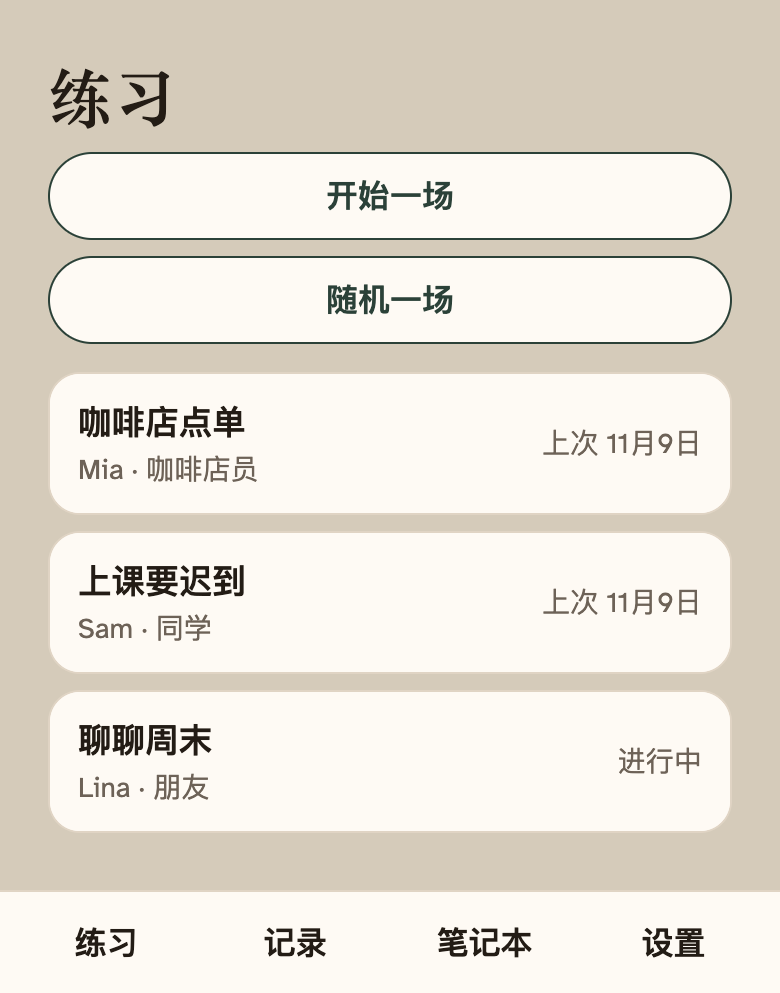
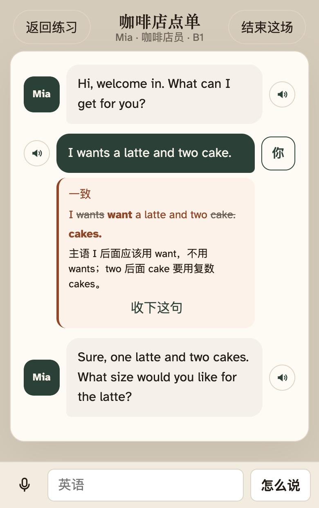
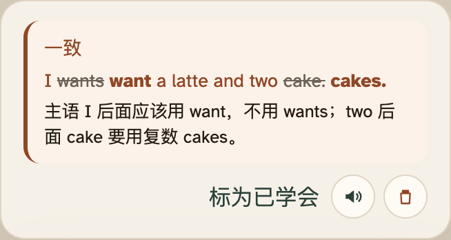
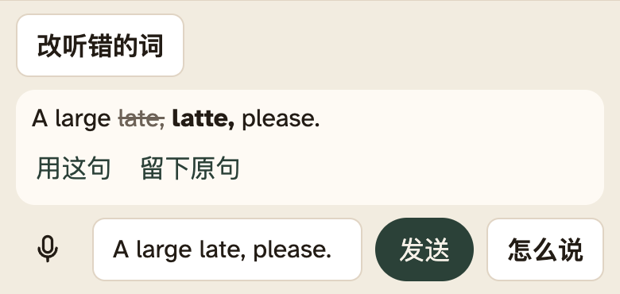

# Speak With Me

给自己练口语的一层练习。聊天把英语接下去，说完再单独改这句，不知道怎么讲时先用中文问一句。练习、词典和笔记留在这台设备上。模型和语音用你自己的密钥。

<p align="center">
  
  
  
  
</p>

<p align="center">
  首页 · 对话里的指正 · 笔记本 · 发送前改听错的词
</p>

## 为什么分成三件事

一场对话里，三件事不混在同一次回复里。

- **聊天**只把英语接下去。不改语法，不切中文。一场不限句数。超过 8 句之后，更早的内容收成一段「已经谈过什么」，最近 8 句原文仍发给模型。
- **指正**在你这句话发出去、对方回复之后单独看。原句留在气泡里，改动用划掉再换上的方式标出来，下面有一句中文说明。
- **怎么说**接收你的中文，给你一句能直接说的英语。点一下才会进入对话。聊天角色看不到这句中文。

点开头像可以看对方这句的中文。译过一次就留在这句上。

## 能做什么

- 从场景开始一场对话，选定水平和对方。首页可以留下常练的场景。
- 按住说话。松开之后字留在发送前的输入框里，可以改，再决定发不发。接着说时，新的一句接在还没发出去的文字后面。
- 发送前可以点「改听错的词」。模型按刚才的对话只换它觉得听错的词，语法和语序留着。你点「用这句」才换上。
- 点句子里的词，用打包在应用里的 ECDICT 词典看释义。这一步不调用模型。
- 句子和词分开放进笔记本。带过指正的句子可以在「带着错误」和「改后的句子」之间换。
- DeepSeek 作为对话来源时，设置里能看余额，并手动刷新。其他来源没有这个接口。
- 换手机或换电脑时，导出一份文件再导入。练习按原来的日期接上。

## 跑起来

需要 Node.js。网页和安卓安装包用同一份 `frontend`。

```bash
git clone https://github.com/Long-zhengtian/SpeakWithMe.git
cd SpeakWithMe/frontend
npm install
npm run dev
```

打开 http://localhost:5173 。到「设置」里保存对话用的密钥，并选一个模型。没有密钥时不能开场。

听写和朗读要另外保存 Azure 的密钥和终结点。Mia 用 Jenny，Lina 用 Aria，Sam 用 Guy。这个区域没有对应嗓音时，会换成同性别的标准英语嗓音。

也可以在 GitHub 上用 Codespaces 打开。云端会装好依赖并打开练习页。密钥只留在那台云端环境里。

[](https://codespaces.new/Long-zhengtian/SpeakWithMe)

## 密钥

对话可以接 OpenAI、Grok、智谱 GLM、DeepSeek，或一个兼容 Chat Completions 的地址。每一家的地址、密钥和模型分开保存。点到另一家只是去看它，保存之后练习才改用那一家。

密钥写在这台设备自己的记录里。页面上只显示末尾几位。导出的备份文件里有练习、笔记本和密钥，换设备时要注意这份文件给谁。

## 安卓安装包

Capacitor 只做外壳。安装包里有编好的页面和 ECDICT 词典，打开后直接调用设置里保存的模型地址。

需要 JDK 21 和 Android SDK。Gradle 8 不能用 Java 25。

```bash
export JAVA_HOME="你的 JDK 21"
export ANDROID_HOME="你的 Android SDK"
export PATH="$JAVA_HOME/bin:$ANDROID_HOME/platform-tools:$PATH"

cd frontend
npm install
npm run build
npx cap sync android
cd android && ./gradlew assembleDebug --no-daemon
```

调试包在 `frontend/android/app/build/outputs/apk/debug/app-debug.apk`。当前调试包是 1.8.0。

装到手机上：

```bash
adb install -r frontend/android/app/build/outputs/apk/debug/app-debug.apk
```

`-r` 会盖过同名调试包，练习记录留在手机上。手机上的记录和电脑浏览器是分开的，换过去之前用「设置 → 换设备」导出。

## 仓库里另外两块

现在的练习都在 `frontend`。`backend/` 是上一版网页服务，新功能不写在那里。

本地小模型留在标签 `speech-local-models`。权重没有放进 git。

```bash
git checkout speech-local-models
cd frontend && sh scripts/fetch-local-speech-models.sh
```

各角色发给模型的提示词写在 `frontend/src/engine/catalog.ts`。

## 还没做

账号、云同步、发音评分，以及腾讯云和阿里云的语音。iOS 还没做。
